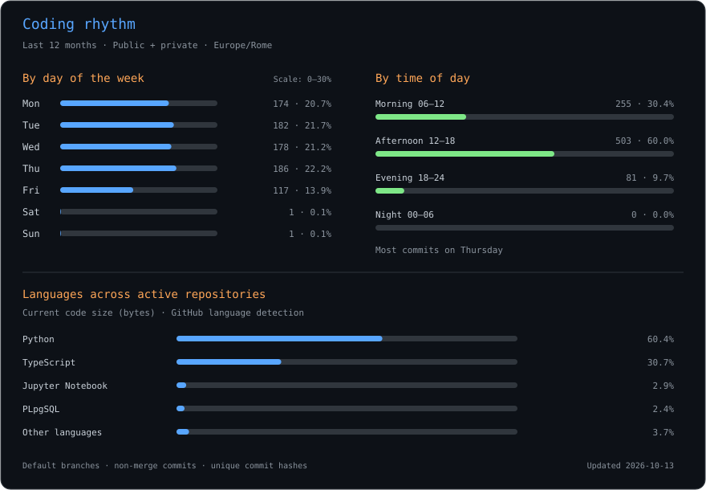

<picture>
  <source media="(prefers-color-scheme: dark)" srcset="assets/profile-dark.svg">
  <source media="(prefers-color-scheme: light)" srcset="assets/profile-light.svg">
  
</picture>

<picture>
  <source media="(prefers-color-scheme: dark)" srcset="assets/activity-dark.svg">
  <source media="(prefers-color-scheme: light)" srcset="assets/activity-light.svg">
  
</picture>

[LinkedIn](https://www.linkedin.com/in/lorenzo-gentile) · [Email](mailto:lorengentile1892@gmail.com)

<!-- Edit profile.json to change the profile text and statistics period. -->
